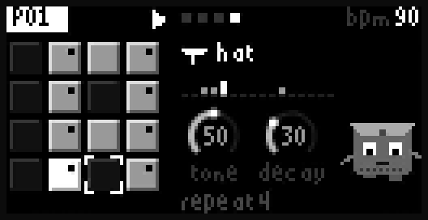
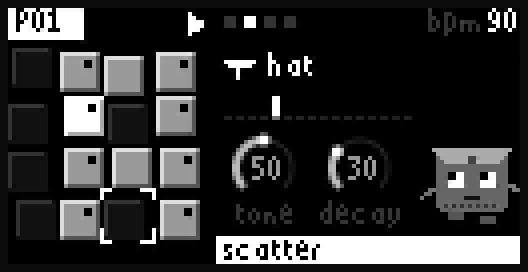

# poche

A drum machine for your pocket: sixteen synthesised sounds, sixteen steps,
sixteen patterns, two knobs per sound, and effects you punch in while you
hold them. No samples — and poche, the little pocket on the screen, dances
to it.

## Install

- **norns-js**: open the scripts store (the bag button, top right), find it on the *made for
  norns-js* shelf, press **get**, then **restart** when the page asks.
- **norns**: in maiden, `;install https://github.com/pinktentacle/poche`,
  then SYSTEM > RESTART once so its engine is loaded.

## Play

| | |
|---|---|
| E1 | choose the sound |
| E2 | move along the steps |
| E3 | knob A of the sound (with K1: knob B) |
| K2 | write or erase the step |
| K3 | play / stop |
| K1 + E1 | choose an effect |
| hold K1, hold K3 | the effect, for as long as K3 is held |
| K1 + E2 | choose the pattern |

The sounds: kick, boom, snare, clap, hats, rim, toms, cowbell, shaker, zap,
bass, lead, stab and sweep. The effects: repeats, rolls, reverse, half
speed, octaves, filters, crush, echo and scatter. A grid, if there is one,
shows seven sounds at once, and the effects on its last row.

## Licence

MIT, see [LICENSE](LICENSE).
